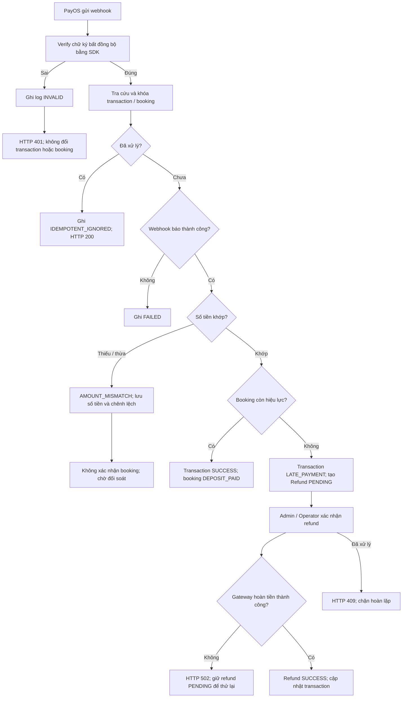

# TF1A207 — Kiểm thử webhook thanh toán và hoàn tiền

- Ngày chạy: `2026-11-22`
- Nhánh: `feature/TF1A207-test-webhook-hoan-tien`
- Cơ sở dữ liệu test: SQLite in-memory qua FastAPI `TestClient`; không dùng DB dự án.
- Kết quả backend: **121 passed, 23 skipped**. Toàn bộ 23 test bị skip là test cần MySQL và `TEST_DATABASE_URL`/`DATABASE_URL_TEST`.
- Mô phỏng gateway riêng: `backend/tests/test_payment_gateway.py` — tất cả kịch bản trong script **PASSED**.

## Phạm vi và phát hiện

- PayOS webhook: xác minh chữ ký qua SDK, chống webhook lặp, đối chiếu `orderCode`/số tiền, ghi log và đồng bộ booking.
- Webhook sandbox HMAC: xác minh chữ ký, idempotency, trạng thái thanh toán và hoàn tiền.
- Hoàn tiền vận hành: hàng chờ bất thường, xác nhận bởi Admin/Operator, từ chối xác nhận lặp và giữ yêu cầu PENDING khi gateway thất bại.
- Frontend `frontend/pages/operations-anomalies.html` và `frontend/js/operations-anomalies.js` gọi đúng các API hàng chờ/xác nhận, hiển thị trạng thái lỗi và yêu cầu xác nhận. Không sửa UI; repo hiện không có bài test frontend tương ứng.

Đã sửa lỗi PayOS SDK: `verifyPaymentWebhookData()` là coroutine nhưng trước đây chưa được `await`, khiến chữ ký không thực sự được xác minh. Đã đổi wrapper thành async và chờ kết quả trước khi xử lý. Test sai chữ ký gọi SDK thật với checksum key giả, không dùng secret môi trường. Với thanh toán thiếu/thừa, giao dịch được phân loại `AMOUNT_MISMATCH`; webhook log lưu số tiền yêu cầu, số tiền PayOS báo, chiều và số tiền chênh lệch. Cũng bổ sung chặn cập nhật thành công nếu gateway hoàn tiền của endpoint `/payments/refund` trả thất bại.

## Bảng kết quả

| Mã TC | Kịch bản / Input | Kết quả mong đợi | Kết quả thực tế |
|---|---|---|---|
| TC01 | Gửi cùng webhook PayOS hợp lệ hai lần; giao dịch `PENDING`, số tiền đúng | Lần đầu xử lý; lần sau idempotent, không nhân đôi trạng thái/hoàn tiền | **PASS** — hai HTTP `200`; giao dịch `SUCCESS`, booking `DEPOSIT_PAID`, `paid_at` không đổi; log `SUCCESS` rồi `IDEMPOTENT_IGNORED`; không tạo refund |
| TC02 | Chữ ký PayOS sai; giao dịch `PENDING` | Từ chối; không cập nhật giao dịch/booking; ghi log chữ ký sai | **PASS** — HTTP `401`; giao dịch vẫn `PENDING`, booking vẫn `PENDING_PAYMENT`; log `INVALID` / `REJECTED_INVALID_SIGNATURE` |
| TC03 | Thiếu tiền: yêu cầu `200000`, webhook báo `199000` | Không xác nhận thanh toán; phân loại bất thường và lưu chênh lệch | **PASS** — HTTP `200` để PayOS không retry; transaction `AMOUNT_MISMATCH`, booking không đổi; log `AMOUNT_MISMATCH`, ghi “thiếu `1000 VND`”; không tạo refund tự động |
| TC04 | Thừa tiền: yêu cầu `200000`, webhook báo `201000` | Không xác nhận thanh toán; phân loại bất thường và lưu chênh lệch | **PASS** — HTTP `200`; transaction `AMOUNT_MISMATCH`, booking không đổi; log ghi “thừa `1000 VND`”; không tạo refund tự động |
| TC05 | Operator xác nhận refund `PENDING` của giao dịch thanh toán muộn | Gọi gateway; khi thành công cập nhật refund và transaction; chặn xác nhận lại | **PASS** — lần đầu HTTP `200`, refund `SUCCESS`, transaction `REFUNDED`, `processed_by=900`; lần hai HTTP `409` |
| TC06 | Gateway từ chối refund vận hành | Báo lỗi; không đánh dấu đã hoàn | **PASS** — HTTP `502`; refund giữ `PENDING`, transaction giữ `LATE_PAYMENT` |
| TC07 | Gateway từ chối refund qua endpoint `/payments/refund` | Báo lỗi; không tạo refund hoặc đổi trạng thái booking/transaction | **PASS** — HTTP `502`; không tạo refund; transaction `SUCCESS`, booking `PENDING_PAYMENT` giữ nguyên |
| TC08 | Webhook sandbox HMAC sai chữ ký; sau đó webhook hợp lệ gửi lặp | Sai chữ ký bị từ chối; webhook hợp lệ idempotent; refund chỉ xử lý một lần | **PASS** — script `test_payment_gateway.py`: chữ ký sai HTTP `401`, giao dịch thành công, lần lặp được bỏ qua, refund thành công, lần refund thứ hai bị từ chối |

Các test nghiệp vụ PayOS (TC01, TC03, TC04) giả lập verifier trả hợp lệ để tập trung kiểm tra xử lý DB mà không cần gọi PayOS thật. TC02 chạy xác minh chữ ký sai qua SDK PayOS bằng cấu hình giả. Hoàn tiền dùng gateway mock/sandbox; **không thực hiện chuyển tiền thật**.

## Sơ đồ luồng



## Lệnh chạy lại

Từ PowerShell tại thư mục dự án:

```powershell
Set-Location backend
.\.venv\Scripts\python.exe -m pytest -q -rs --disable-warnings
$env:PYTHONIOENCODING = "utf-8"
.\.venv\Scripts\python.exe tests\test_payment_gateway.py
```

Các test MySQL bị skip nếu chưa cấu hình `TEST_DATABASE_URL` hoặc `DATABASE_URL_TEST` trỏ tới database test an toàn. Không trỏ các test này vào DB production. Không cần bật server hoặc cấu hình PayOS thật để chạy các test nêu trên.

## Phạm vi chưa kiểm thử

- Chưa gọi PayOS thật, MySQL thật hoặc thực hiện chuyển/hoàn tiền thật.
- 23 test yêu cầu MySQL bị skip do chưa cấu hình database test trong phiên chạy.
- Frontend được rà soát mã nguồn nhưng không có browser/E2E test runner trong repo.
- Chênh lệch thiếu/thừa được gom chung vào trạng thái `AMOUNT_MISMATCH`; chiều và trị số được ghi trong webhook log để vận hành đối soát.
