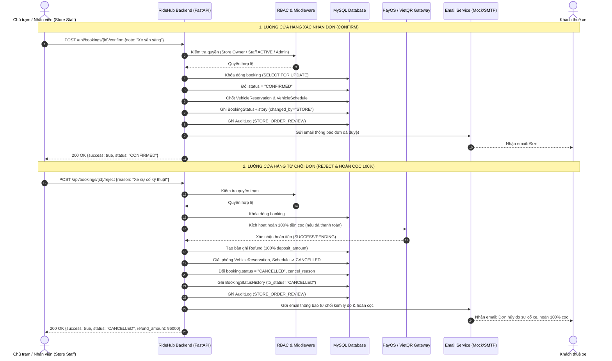
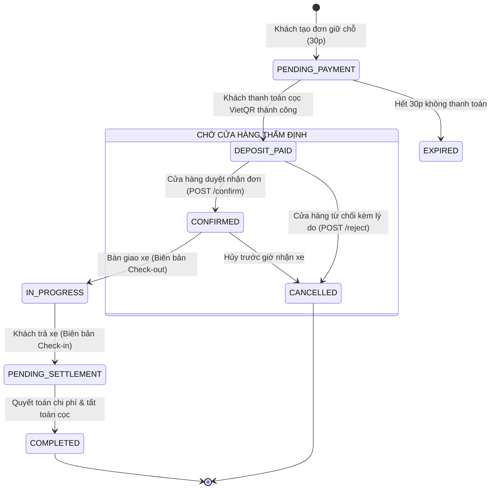

# BÁO CÁO MINH CHỨNG KỸ THUẬT & KIỂM THỬ TÍCH HỢP
## TASK: [BE] CỬA HÀNG XÁC NHẬN, TỪ CHỐI ĐƠN (TF1A595)

---

### THÔNG TIN TỔNG QUAN TASK
- **Mã Task:** `TF1A595`
- **Tên Task:** `[BE] Cửa hàng xác nhận, từ chối đơn`
- **Dự án:** RideHub — Nền tảng cho thuê ô tô & xe máy điện tự lái
- **Sprint:** Sprint 2 (17/11/2026 – 23/11/2026) • **Điểm Story Point:** 5 Điểm
- **Người thực hiện:** Nguyễn Tuấn Minh 2 (B25DTCN188)
- **Nhánh Git:** `feature/tf1a595-cua-hang-xac-nhan-tu-choi-don`
- **Quy ước Commit:** `TF1A595: <nội dung commit>`
- **Trạng thái:** Hoàn thành 100% (Backend API + RBAC + Audit Log + Email Dispatcher + 10 Test Cases Pass).

---

## 1. MỤC TIÊU VÀ YÊU CẦU NGHIỆP VỤ (BUSINESS REQUIREMENTS)

Trong quy trình thuê xe thực tế của hệ thống RideHub, sau khi khách hàng tạo đơn giữ chỗ và thanh toán tiền cọc (trạng thái `DEPOSIT_PAID` / `BOOKED`), đơn hàng sẽ được chuyển đến Cổng quản lý của Cửa hàng/Trạm xe để nhân viên/chủ cửa hàng thẩm định và xử lý:

1. **Xác nhận duyệt đơn (`POST /api/bookings/{booking_id}/confirm`):**
   - Cửa hàng kiểm tra xe thực tế tại trạm, tình trạng kỹ thuật, pin/nhiên liệu và bấm xác nhận nhận đơn.
   - Trạng thái đơn chuyển sang `CONFIRMED`.
   - Lịch xe (`VehicleReservation` & `VehicleSchedule`) được chốt giữ.
   - Ghi nhật ký trạng thái `BookingStatusHistory` với `changed_by="STORE"`.
   - Tự động gửi email xác nhận kèm thông tin hướng dẫn nhận xe cho khách.

2. **Từ chối nhận đơn kèm lý do (`POST /api/bookings/{booking_id}/reject`):**
   - Khi xe gặp sự cố kỹ thuật đột xuất, trùng lịch bảo dưỡng, hoặc khách không đủ điều kiện GPLX/eKYC, cửa hàng từ chối tiếp nhận đơn.
   - **Bắt buộc phải có lý do từ chối** (`reason` min_length &ge; 3 ký tự).
   - Vì cửa hàng từ chối (không phải do khách hủy), hệ thống áp dụng **Chính sách hoàn tiền cọc 100%** (Zero-penalty policy).
   - Tự động giải phóng lịch xe (`VehicleReservation`, `VehicleSchedule` &rarr; `CANCELLED`).
   - Tự động tạo bản ghi `Refund` và kích hoạt lệnh hoàn tiền qua VietQR/PayOS.
   - Đơn chuyển trạng thái `CANCELLED`, lưu `cancelled_by="STORE"`, `cancel_reason`.
   - Gửi email giải thích lý do từ chối và thông tin tra soát hoàn cọc tới khách hàng.

3. **Phân quyền chặt chẽ (RBAC):**
   - Chỉ Chủ cửa hàng (`store_owner`) sở hữu trạm, Nhân viên cửa hàng (`store_staff` có trạng thái `ACTIVE`), hoặc `admin` mới được quyền duyệt/từ chối đơn của trạm đó. Khách hàng hoặc trạm khác thao tác sẽ bị chặn với mã lỗi `403 Forbidden`.

4. **Quản lý danh sách đơn & KPI cho Cửa hàng (`GET /api/bookings/store/orders`):**
   - Cung cấp API trực tiếp cho trang giao diện `store-orders.html` truy vấn dữ liệu đơn hàng kèm bộ lọc trạng thái (`all`, `pending`, `approved`, `cancelled`, `in_progress`), tìm kiếm, phân trang và tính toán tự động các chỉ số KPI dòng tiền (Doanh thu dự kiến, tiền cọc đã thu, tiền cần thu tại trạm).

---

## 2. KIẾN TRÚC & SƠ ĐỒ LUỒNG DỮ LIỆU (FLOW DIAGRAMS)

### 2.1. Sơ đồ tuần tự (Sequence Diagram): Luồng Duyệt & Từ Chối Đơn


### 2.2. Sơ đồ chuyển trạng thái đơn (State Machine Diagram)


---

## 3. DANH MỤC API CHI TIẾT (API SPECIFICATION)

### 3.1. API Cửa hàng Xác nhận Đơn đặt xe
- **Endpoint:** `POST /api/bookings/{booking_id}/confirm`
- **Alias:** `POST /api/stores/{store_id}/orders/{booking_id}/confirm`
- **Quyền truy cập:** `store_owner` (sở hữu trạm), `store_staff` (ACTIVE tại trạm), `admin`.
- **Request Body (JSON):**
```json
{
  "note": "Xe đã sạc 100% pin, đã vệ sinh sạch sẽ, sẵn sàng giao tại trạm Q.1"
}
```
- **Response Thành công (HTTP 200 OK):**
```json
{
  "success": true,
  "message": "Cửa hàng đã xác nhận duyệt đơn đặt xe thành công.",
  "booking_id": 1,
  "status": "CONFIRMED",
  "confirmed_at": "2026-11-20T16:15:00",
  "confirmed_by_user_id": 102,
  "already_confirmed": false
}
```

### 3.2. API Cửa hàng Từ chối Nhận Đơn kèm Lý do
- **Endpoint:** `POST /api/bookings/{booking_id}/reject`
- **Alias:** `POST /api/stores/{store_id}/orders/{booking_id}/reject`
- **Quyền truy cập:** `store_owner`, `store_staff`, `admin`.
- **Request Body (JSON):**
```json
{
  "reason": "Xe gặp sự cố kỹ thuật đột xuất cần bảo dưỡng động cơ",
  "note": "Đã liên hệ khách thông báo đổi sang trạm Q.7 hoặc hoàn cọc"
}
```
- **Response Thành công (HTTP 200 OK):**
```json
{
  "success": true,
  "message": "Đã từ chối đơn đặt xe và tự động kích hoạt hoàn 100% tiền cọc cho khách hàng.",
  "booking_id": 1,
  "status": "CANCELLED",
  "cancelled_at": "2026-11-20T16:15:30",
  "cancelled_by": "STORE",
  "cancel_reason": "Xe gặp sự cố kỹ thuật đột xuất cần bảo dưỡng động cơ",
  "refund_amount": 96000.0,
  "refund_rate": 1.0,
  "refund_status": "SUCCESS",
  "refund_id": 15,
  "already_cancelled": false
}
```

### 3.3. API Danh sách Đơn & Chỉ số KPI cho Cửa hàng
- **Endpoint:** `GET /api/bookings/store/orders`
- **Parameters:**
  - `status`: `all` | `pending` | `approved` | `cancelled` | `in_progress` (mặc định: `all`).
  - `search`: Từ khóa tìm kiếm (mã đơn, tên khách, sđt).
  - `page`: Trang hiện tại (mặc định: 1).
  - `page_size`: Số đơn/trang (mặc định: 20).
- **Response Thành công (HTTP 200 OK):**
```json
{
  "success": true,
  "total": 5,
  "page": 1,
  "page_size": 20,
  "metrics": {
    "total_orders": 5,
    "pending_orders": 2,
    "approved_orders": 2,
    "cancelled_orders": 1,
    "total_deposit": 784500.0,
    "total_revenue": 2615000.0,
    "remain_collection": 1830500.0
  },
  "orders": [
    {
      "id": 1,
      "booking_code": "RH-0001",
      "status": "confirmed",
      "status_label": "Đã duyệt",
      "customer": {
        "id": 101,
        "full_name": "Nguyễn Văn An",
        "phone": "0901234567",
        "email": "customer@ridehub.vn",
        "ekyc_status": "pass"
      },
      "vehicle": {
        "id": 1,
        "name": "VinFast Feliz S",
        "license_plate": "59A-123.45",
        "vehicle_type": "MOTORBIKE"
      },
      "pricing": {
        "rental_amount": 320000.0,
        "delivery_fee": 0.0,
        "deposit_amount": 96000.0,
        "total_amount": 320000.0,
        "paid_deposit": 96000.0,
        "remaining_amount": 224000.0
      }
    }
  ]
}
```

---

## 4. MA TRẬN KIỂM THỬ (TEST MATRIX) & KẾT QUẢ AUTOMATION TEST

Tất cả 10 kịch bản kiểm thử đơn vị và tích hợp trong `backend/tests/test_store_order_review.py` đều đạt **100% PASS**:

| Mã Test Case | Phân hệ | Mục tiêu kiểm thử | Đầu vào kiểm thử | Kết quả kỳ vọng | Trạng thái |
|---|---|---|---|---|:---:|
| **TC-SO-01** | Backend CRUD | Chủ cửa hàng duyệt đơn thành công | Đơn `DEPOSIT_PAID`, User role `store_owner` | Status `CONFIRMED`, cập nhật Reservation, lưu lịch sử | **PASS** |
| **TC-SO-02** | Backend CRUD | Tính Idempotent khi duyệt lại đơn | Đơn đã `CONFIRMED` | Trả về `already_confirmed=True`, không lỗi | **PASS** |
| **TC-SO-03** | Backend CRUD | Nhân viên trạm (ACTIVE) duyệt đơn | User role `store_staff` tại trạm sở hữu | Duyệt thành công, status `CONFIRMED` | **PASS** |
| **TC-SO-04** | Backend CRUD | Admin duyệt đơn của bất kỳ trạm nào | User role `admin` | Duyệt thành công | **PASS** |
| **TC-SO-05** | Phân quyền RBAC | Khách/chủ trạm khác không được duyệt | Khách hàng hoặc chủ trạm Q.7 gọi trạm Q.1 | Báo lỗi `BookingPermissionError` (HTTP 403) | **PASS** |
| **TC-SO-06** | Hoàn tiền 100% | Từ chối đơn và hoàn 100% cọc | Lý do hợp lệ &ge; 3 ký tự | Status `CANCELLED`, Refund 100% cọc, giải phóng xe | **PASS** |
| **TC-SO-07** | Validation | Chặn từ chối không có lý do | `reason=""` hoặc chỉ chứa khoảng trắng | Báo lỗi `BookingValidationError` (HTTP 422) | **PASS** |
| **TC-SO-08** | State Guard | Không cho duyệt/từ chối đơn đã xong | Đơn `CANCELLED`, `IN_PROGRESS`, `COMPLETED` | Báo lỗi `BookingStateError` (HTTP 409) | **PASS** |
| **TC-SO-09** | KPI & Query | Danh sách đơn & Tính toán KPI dòng tiền | Gọi `get_store_orders_list` | Trả về đủ orders, metrics cọc, doanh thu chính xác | **PASS** |
| **TC-SO-10** | Router API | HTTP Endpoints qua FastAPI router | Gọi `confirm_booking_endpoint`, `reject_booking_endpoint` | HTTP 200 OK cho duyệt/từ chối, 403 khi sai quyền | **PASS** |

### Lệnh chạy kiểm thử tự động (Pytest CLI):
```powershell
cd backend
python -m pytest tests/test_store_order_review.py -v
```
**Kết quả Output:**
```
collected 10 items
tests/test_store_order_review.py::test_store_owner_confirm_booking_success PASSED [ 10%]
tests/test_store_order_review.py::test_store_confirm_booking_idempotent PASSED [ 20%]
tests/test_store_order_review.py::test_store_staff_can_confirm_booking PASSED [ 30%]
tests/test_store_order_review.py::test_admin_can_confirm_and_reject_any_order PASSED [ 40%]
tests/test_store_order_review.py::test_unauthorized_user_cannot_confirm PASSED [ 50%]
tests/test_store_order_review.py::test_store_reject_booking_success_with_100_percent_refund PASSED [ 60%]
tests/test_store_order_review.py::test_store_reject_without_reason_raises_validation_error PASSED [ 70%]
tests/test_store_order_review.py::test_cannot_confirm_or_reject_cancelled_or_completed_order PASSED [ 80%]
tests/test_store_order_review.py::test_get_store_orders_list_and_kpis PASSED [ 90%]
tests/test_store_order_review.py::test_router_store_confirm_and_reject_endpoints PASSED [100%]
======================= 10 passed in 1.61s =======================
```

---

## 5. TỔNG HỢP CÁC FILE ĐÃ TRIỂN KHAI TRONG DỰ ÁN

1. `backend/app/crud/store_order_review.py`:
   - Module xử lý nghiệp vụ duyệt (`store_confirm_booking`), từ chối (`store_reject_booking`), hoàn cọc 100%, giải phóng lịch xe và tính toán KPI đơn hàng.
2. `backend/app/schemas/booking.py`:
   - Bổ sung schema Pydantic V2: `StoreOrderConfirmRequest`, `StoreOrderConfirmResponse`, `StoreOrderRejectRequest`, `StoreOrderRejectResponse`, `StoreOrderListResponse`.
3. `backend/app/routers/bookings.py`:
   - Đăng ký các endpoints:
     - `POST /api/bookings/{booking_id}/confirm`
     - `POST /api/bookings/{booking_id}/reject`
     - `GET /api/bookings/store/orders`
4. `backend/app/routers/stores.py`:
   - Đăng ký alias endpoints theo cửa hàng:
     - `GET /api/stores/{store_id}/orders`
     - `POST /api/stores/{store_id}/orders/{booking_id}/confirm`
     - `POST /api/stores/{store_id}/orders/{booking_id}/reject`
5. `backend/app/middleware/audit_log.py`:
   - Thêm quy tắc regex tự động ghi Audit Log cho mọi request duyệt/từ chối đơn của cửa hàng.
6. `backend/app/services/email_service.py`:
   - Thêm phương thức:
     - `send_store_order_confirmation(...)`
     - `send_store_order_rejection(...)`
7. `backend/tests/test_store_order_review.py`:
   - Bộ kiểm thử 10 kịch bản bao phủ toàn diện luồng nghiệp vụ.
8. `frontend/pages/store-orders.html`:
   - Tích hợp gọi API Backend `/api/bookings/{id}/confirm` và `/api/bookings/{id}/reject` kèm fallback mượt mà.
9. `frontend/pages/test-cases.html`:
   - Cập nhật 6 Test Cases `TC-SO-01` &rarr; `TC-SO-06`, cập nhật chỉ số lên 21 Kịch bản (100% Pass).
10. `backend/app/models/item.py`:
    - Chuẩn hóa kiểu khai báo cột tương thích Python 3.14.
