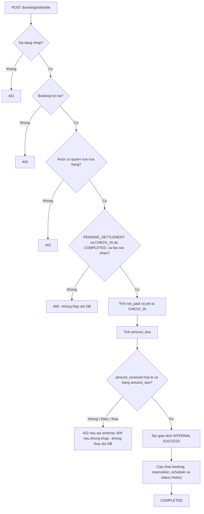

# TF1B171 - Test tat toan va phi phat sinh

**Ghi chu task:** Test tat toan va phi phat sinh
**Endpoint:** `POST /api/bookings/{booking_id}/settle`

## Luong va quy tac da kiem tra

- Chi tai toan booking `PENDING_SETTLEMENT`; bien ban `CHECK_IN` moi nhat phai `COMPLETED` va `both_confirmed=true`.
- Can dang nhap. Quyen duoc phep: admin/operator, chu cua hang cua booking, hoac nhan vien cua hang co trang thai `ACTIVE`.
- Phi phat sinh lay tu bien ban CHECK_IN: overtime, vuot km, nhien lieu, ve sinh va hu hong. Schema bien ban tu choi so am, sai dinh dang tien hoac qua 2 chu so thap phan.
- `net_paid = max(0, tong giao dich SUCCESS - tong refund SUCCESS/REFUNDED - refund_immediate)`.
- `amount_due = max(0, booking.total_amount - net_paid) + tong phi phat sinh`.
- Request phai gui `amount_received` khong am, toi da 2 chu so thap phan. Backend chi tao giao dich cuoi va chuyen booking sang `COMPLETED` neu so tien nay bang chinh xac `amount_due`; sai lech tra `409` va khong tao giao dich/doi trang thai.
- Giao dich cuoi va lich su trang thai duoc ghi trong cung transaction DB; booking, reservation va schedule chuyen sang `COMPLETED`. Tat toan lai bi chan.



## Bang ket qua

Fixture API dung SQLite trong bo nho, FastAPI `TestClient`, va booking co tong tien `300,000 VND`. Tien coc da thanh toan `200,000`, refund `25,000`, phi phat sinh `35,000`; do do `amount_due = 160,000 VND`.

| Ma TC | Kich ban / input | Ket qua mong doi | Ket qua thuc te |
|---|---|---|---|
| TC-SET-01 | Tat toan dung; `amount_received=160000`, method `BANK_TRANSFER` | `200`; due `160,000`; giao dich cuoi `SUCCESS`; booking hoan tat | **PASS** - net paid `175,000`, con lai `125,000`, phi `35,000`, giao dich cuoi `160,000`; booking/history/reservation/schedule `COMPLETED` |
| TC-SET-02 | Khong co giao dich coc truoc; due `300,000 + 35,000` | Thu du toan bo va phi | **PASS** - amount due `335,000`, `200` |
| TC-SET-03 | Da thanh toan du, khong co phi/refund; `amount_received=0` | Cho tat toan 0 dong, khong tinh am | **PASS** - giao dich `NO_CHARGE` 0 dong, response `200` |
| TC-SET-04 | Refund ghi truc tiep tren CHECK_IN `25,000` | Tru refund khoi tien da thanh toan | **PASS** - refunded `25,000`, net paid `175,000`, due `160,000`, response `200` |
| TC-SET-05 | Thieu tien `159,999` so voi due `160,000` | Tu choi, khong tao giao dich cuoi/hoan tat booking | **PASS** - `409`; booking van `PENDING_SETTLEMENT`; chi con giao dich coc |
| TC-SET-06 | Thu thua `160,001` so voi due `160,000` | Tu choi sai lech, khong ghi nhan tien thua | **PASS** - `409`; DB khong doi |
| TC-SET-07 | Thieu `amount_received` | Tu choi request, khong ghi nhan | **PASS** - `422`; DB khong doi |
| TC-SET-08 | `amount_received` am, qua 2 so le, hoac chuoi khong phai so | Tu choi schema | **PASS** - `422` |
| TC-SET-09 | Phi CHECK_IN am/sai scale/sai kieu | Tu choi schema phi | **PASS** - `ValidationError` |
| TC-SET-10 | Phi da luu trong DB la so am | Bao loi validation, khong hoan tat | **PASS** - API `422` |
| TC-SET-11 | Goi tat toan booking da `COMPLETED` lan nua | Chan lap giao dich | **PASS** - `409`; chi 1 giao dich cuoi va 1 history `COMPLETED` |
| TC-SET-12 | Booking o `IN_PROGRESS` thay vi `PENDING_SETTLEMENT` | Chan sai state | **PASS** - `409`; trang thai va so giao dich giu nguyen |
| TC-SET-13 | CHECK_IN chua `COMPLETED` hoac chua du xac nhan hai ben | Chan tat toan | **PASS** - `409`; khong tao giao dich cuoi |
| TC-SET-14 | Booking ID khong ton tai | Tra not found | **PASS** - `404` |
| TC-SET-15 | Khong co session dang nhap | Tu choi truy cap | **PASS** - `401` |
| TC-SET-16 | User khong thuoc cua hang booking | Tu choi quyen | **PASS** - `403` |
| TC-SET-17 | Payment method khong duoc ho tro (`CRYPTO`) | Tu choi schema | **PASS** - `422` |
| TC-SET-18 | Nhan vien cua hang `ACTIVE` cua booking | Cho phep tat toan | **PASS** - `200`, booking va giao dich duoc hoan tat |
| TC-SET-19 | Nhan vien cua hang `INACTIVE` | Tu choi quyen | **PASS** - `403` |

## Ket qua chay

- Bo test settlement + handover + payment: **69 passed**.
- Toan bo backend: **179 passed, 23 skipped, 1 failed**. Loi duy nhat la test ngoai pham vi `tests/test_chatbot_ai.py::test_02_knowledge_base_rag_context_building`: fixture RAG tra ve cau hoi/cau tra loi nhung khong co tieu de ma assertion mong doi. Khong sua loi khong lien quan nay.
- Test DB la SQLite trong bo nho qua API TestClient; khong co ket noi MySQL/prod. Bo test MySQL bi skip trong moi truong nay.
- `amount_received` la so tien nhan vien xac nhan da thu; endpoint khong tu xac minh giao dich ngan hang/cash voi nha cung cap. Voi chuyen khoan, doi chieu chung tu ben ngoai truoc khi goi API.

## Chay lai tren Windows

Tu thu muc goc repo:

```powershell
cd .\backend
.\.venv\Scripts\python.exe -m pytest tests\test_booking_settlement.py tests\test_handover_protocol.py tests\test_payment_flow.py tests\test_payment_operations.py -q
```

Chay toan bo backend:

```powershell
cd .\backend
.\.venv\Scripts\python.exe -m pytest -q
```

Request tat toan thanh cong can gui `amount_received`, vi du `{"amount_received": 160000, "payment_method": "BANK_TRANSFER"}`. Tien can nhan phai bang dung so tien `amount_due` backend tinh tu booking, payment/refund thanh cong va phi CHECK_IN.
