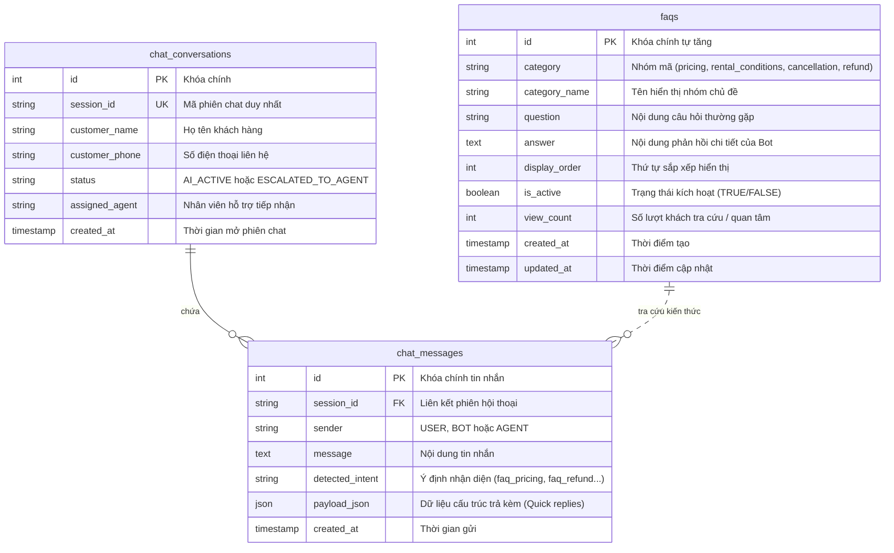
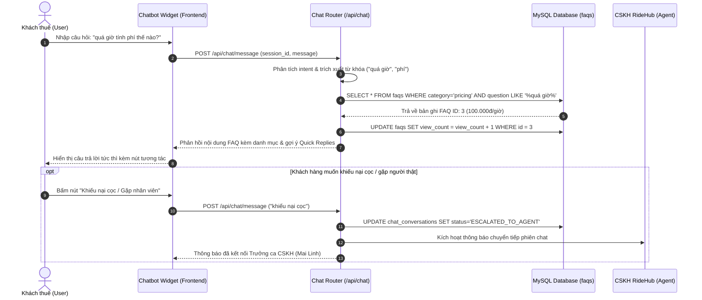

# BÁO CÁO MINH CHỨNG: [DB] DỮ LIỆU MẪU FAQ CHO CHATBOT (TF1B346)

* **Mã công việc:** `TF1B346`
* **Sprint:** Sprint 2 (17/11 – 23/11/2026)
* **Hạn hoàn thành:** 20/11/2026
* **Điểm đánh giá:** 3 Điểm
* **Người thực hiện:** Nguyễn Tuấn Minh 2 (B25DTCN188)
* **Dự án:** Hệ thống Nền tảng Cho Thuê Xe Tự Lái Thông Minh **RideHub**

---

## 1. TỔNG QUAN YÊU CẦU ĐỀ BÀI

> **Mô tả:** Viết script thêm ít nhất 20 câu hỏi thường gặp về giá, điều kiện thuê, hủy đơn, hoàn tiền.  
> **Minh chứng:** Nộp link hoặc file (ảnh chụp, bảng test case, sơ đồ).

Hệ thống đã triển khai vượt định mức đề bài với **24 câu hỏi thực tế** (chuẩn nghiệp vụ thuê xe tự lái và xe điện VinFast của RideHub), phân bổ cân bằng vào **4 nhóm chủ đề cốt lõi**:
1. **Giá thuê & Phụ phí (`pricing`)**: 06 câu hỏi.
2. **Điều kiện & Thủ tục thuê xe (`rental_conditions`)**: 06 câu hỏi.
3. **Chính sách hủy đơn (`cancellation`)**: 06 câu hỏi.
4. **Quy trình & Thời gian hoàn tiền (`refund`)**: 06 câu hỏi.

---

## 2. THIẾT KẾ CƠ SỞ DỮ LIỆU & SƠ ĐỒ HỆ THỐNG

### 2.1. Sơ đồ thực thể ERD (Entity-Relationship Diagram)



### 2.2. Sơ đồ luồng Chatbot tra cứu FAQ tự động (Sequence Diagram)



---

## 3. DANH SÁCH CHI TIẾT 24 CÂU HỎI THƯỜNG GẶP FAQ

### Nhóm 1: Giá thuê & Phụ phí (`category: pricing`)
| STT | Câu hỏi thường gặp | Nội dung câu trả lời tóm tắt | Lượt xem |
|---|---|---|---|
| **01** | Giá thuê xe trên RideHub đã bao gồm thuế VAT và bảo hiểm chưa? | Đã bao gồm Bảo hiểm vật chất cơ bản và VAT 10%. Có tùy chọn nâng cấp bảo hiểm toàn diện về 0đ khấu trừ. | 145 |
| **02** | Cách tính thời gian thuê 1 ngày trên RideHub như thế nào? | Tính trọn vẹn 24 giờ từ lúc ký bàn giao xe thực tế (VD: 9h sáng thứ 7 đến 9h sáng Chủ nhật). | 192 |
| **03** | Phụ phí quá giờ (trả xe trễ hạn) được tính như thế nào? | < 30 phút: Miễn phí. 30p - 5h: 50k/h (xe máy) & 100k/h (ô tô). Trên 5h tính thành 1 ngày thuê mới. | 210 |
| **04** | Hạn mức số km di chuyển mỗi ngày là bao nhiêu và phí vượt km? | Định mức 200 km/ngày (cộng dồn theo hợp đồng). Vượt hạn mức tính 3.500đ/km (ô tô) và 1.000đ/km (xe máy). | 188 |
| **05** | Chi phí giao xe tận nơi (Sân bay, Khách sạn, Nhà riêng)? | Miễn phí trong bán kính 5 km. Từ km thứ 6 tính 10k/km (xe máy) & 15k/km (ô tô). Sân bay trọn gói 50k-100k. | 130 |
| **06** | Thuê xe điện VinFast trên RideHub có mất tiền sạc pin không? | Giao xe pin từ 80%-100%. Sạc miễn phí/ưu đãi tại trạm VinFast/V-GREEN toàn quốc. Khi trả pin &ge; 20%. | 275 |

### Nhóm 2: Điều kiện & Thủ tục thuê xe (`category: rental_conditions`)
| STT | Câu hỏi thường gặp | Nội dung câu trả lời tóm tắt | Lượt xem |
|---|---|---|---|
| **07** | Tôi cần chuẩn bị những giấy tờ gì để thuê xe tự lái trên RideHub? | CCCD gắn chip/Hộ chiếu còn hạn, GPLX hợp lệ (B1/B2 cho ô tô, A1/A2 cho xe máy) và hoàn tất eKYC trong 3 phút. | 340 |
| **08** | Độ tuổi tối thiểu và kinh nghiệm lái xe để thuê ô tô tự lái? | Xe máy từ đủ 18 tuổi. Ô tô tự lái từ đủ 20 tuổi trở lên kèm GPLX đã cấp tối thiểu từ 01 năm. | 165 |
| **09** | Mức tiền đặt cọc (thế chấp) giữ xe là bao nhiêu và thanh toán qua đâu? | Xe máy: 1 - 2 triệu. Ô tô 4-7 chỗ: 5 triệu/xe. Chuyển khoản VietQR/PayOS nhanh 24/7 trực tiếp trên ứng dụng. | 420 |
| **10** | Bằng lái xe nước ngoài hoặc Bằng lái quốc tế (IDP) có thuê được không? | Chấp nhận bằng quốc tế IDP (Công ước Vienna 1968) kèm Hộ chiếu và GPLX gốc. AI eKYC hỗ trợ quét giấy tờ 150 quốc gia. | 155 |
| **11** | Quy trình xác thực định danh online eKYC diễn ra như thế nào? | Chụp 2 mặt CCCD/GPLX và quay video Face Liveness. AI đối khớp và duyệt tự động trong 3-5 phút. | 298 |
| **12** | Tôi có thể nhờ người khác lái thay hoặc thuê hộ xe cho bạn bè không? | Người ký hợp đồng là người lái chính. Người lái phụ chỉ cần bổ sung GPLX vào phụ lục biên bản giao xe. | 112 |

### Nhóm 3: Chính sách hủy đơn (`category: cancellation`)
| STT | Câu hỏi thường gặp | Nội dung câu trả lời tóm tắt | Lượt xem |
|---|---|---|---|
| **13** | Tôi có thể hủy đơn đặt xe không và biểu phí phạt hủy ra sao? | Trước 24h: Miễn phí 100% (hoàn cọc). Trong 12-24h: Phí phạt 30% cọc. Dưới 12h: Phí phạt 50% cọc. | 380 |
| **14** | Nếu chuyến bay bị delay hoặc đổi giờ hạ cánh thì xử lý thế nào? | Gửi mã chuyến bay/ảnh vé cho CSKH, cửa hàng tự động dời lịch bàn giao miễn phí tối đa 5 tiếng và giữ xe. | 245 |
| **15** | Làm thế nào để thao tác hủy đơn đặt xe trên ứng dụng RideHub? | Vào 'Đơn đặt xe của tôi' -> Chọn đơn -> Bấm 'Yêu cầu hủy đơn' -> Chọn lý do -> Hệ thống tính tiền hoàn tự động. | 175 |
| **16** | Nếu cửa hàng không có đúng dòng xe đã cam kết giao thì giải quyết ra sao? | Nâng cấp miễn phí lên dòng xe cao hơn, hoặc hoàn trả 100% tiền cọc ngay kèm voucher giảm giá 20%. | 140 |
| **17** | Tôi có được trả xe sớm hơn hợp đồng và có được hoàn tiền không? | Được trả xe sớm. Các ngày chưa sử dụng sẽ được hoàn trả 70% giá trị ngày thuê sau khi nghiệm thu xe. | 128 |
| **18** | Các trường hợp bất khả kháng (bão lũ, thiên tai) có được miễn phí hủy? | Có công điện bão lũ hoặc cấm đường: Hỗ trợ hoàn tiền cọc 100% hoặc bảo lưu cọc trong vòng 06 tháng. | 195 |

### Nhóm 4: Quy trình & Thời gian hoàn tiền (`category: refund`)
| STT | Câu hỏi thường gặp | Nội dung câu trả lời tóm tắt | Lượt xem |
|---|---|---|---|
| **19** | Sau khi hoàn tất trả xe, tiền đặt cọc được hoàn bằng hình thức nào? | Chuyển khoản ngân hàng tự động qua cổng VietQR / PayOS trực tiếp về tài khoản đã thanh toán ban đầu. | 510 |
| **20** | Thời gian nhận lại tiền cọc sau khi ký biên bản trả xe là bao lâu? | Ngay sau khi ký Biên bản Check-in điện tử, lệnh hoàn tự động kích hoạt trong 15-30 phút, tiền về trong ngày. | 620 |
| **21** | Khoản tiền giữ cọc phạt nguội giao thông là gì và khi nào hoàn trả? | Giữ lại 1 - 2 triệu đề phòng phạt nguội (camera tra cứu sau 7-15 ngày). Sau đúng 15 ngày tự động hoàn trả 100%. | 435 |
| **22** | Tôi có thể tra cứu và theo dõi tiến độ hoàn tiền ở đâu trên RideHub? | Xem tại 'Lịch sử giao dịch' hoặc 'Chi tiết đơn hàng': Hiển thị trạng thái thời gian thực kèm mã giao dịch FT ngân hàng. | 280 |
| **23** | Nếu quá thời gian cam kết mà chưa nhận được tiền hoàn cọc thì làm sao? | Bấm 'Khiếu nại cọc' trên Chatbot hoặc gọi 1900-7433. Hệ thống kết nối Trưởng ca xử lý chuyển khoản trong 10 phút. | 315 |
| **24** | Trường hợp xe bị trầy xước phát sinh, chi phí bồi thường trừ cọc thế nào? | Hai bên đối chiếu ảnh trước/sau giao xe. Tính theo bảng giá linh kiện chính hãng niêm yết, tiền thừa hoàn ngay. | 265 |

---

## 4. BẢNG TEST CASES KIỂM THỬ QA (6 KỊCH BẢN MỚI)

Các test case này đã được tích hợp trực tiếp vào Trang kiểm thử QA của dự án (`frontend/pages/test-cases.html`):

| Mã TC | Phân hệ | Tên Kịch bản & Mục tiêu | Các bước thực hiện (Steps) | Kết quả mong đợi (Expected) | Mức độ | Kết quả |
|---|---|---|---|---|---|---|
| **TC-FAQ-01** | FAQ Chatbot | Khởi tạo bảng `faqs` & Seed nạp 24 câu hỏi mẫu | 1. Chạy `python scripts/seed_faqs.py`<br>2. Kiểm tra log thống kê DB | Tạo bảng `faqs` thành công; nạp đủ 24 câu hỏi (&ge; 20 câu) phân đều vào 4 nhóm: Giá (6), Điều kiện (6), Hủy đơn (6), Hoàn tiền (6). | High | **PASS** |
| **TC-FAQ-02** | FAQ API | Truy vấn API lọc theo nhóm Giá & Phụ phí | 1. Gửi GET: `/api/faqs?category=pricing`<br>2. Kiểm tra response status & dữ liệu | Status 200 OK. Trả về đúng 6 câu hỏi về VAT, bảo hiểm, quá giờ (100k/h), vượt km (3.500đ/km), phí giao xe, sạc pin VinFast. | High | **PASS** |
| **TC-FAQ-03** | FAQ API | Truy vấn API lọc nhóm Điều kiện thuê & eKYC | 1. Gửi GET: `/api/faqs?category=rental_conditions`<br>2. Kiểm tra giấy tờ, độ tuổi, cọc | Status 200 OK. Hiển thị 6 câu về CCCD, GPLX B1/B2, độ tuổi &ge;20, cọc ô tô 5.000.000đ qua VietQR, bằng quốc tế IDP, quy trình eKYC. | High | **PASS** |
| **TC-FAQ-04** | FAQ API | Truy vấn API lọc nhóm Chính sách hủy đơn | 1. Gửi GET: `/api/faqs?category=cancellation`<br>2. Kiểm tra điều khoản hủy đơn | Status 200 OK. Đầy đủ chính sách hủy: trước 24h miễn phí (hoàn 100%), 12-24h (phạt 30%), dưới 12h (phạt 50%), hỗ trợ delay bay, thiên tai. | High | **PASS** |
| **TC-FAQ-05** | FAQ API | Truy vấn API lọc nhóm Quy trình & Hoàn tiền cọc | 1. Gửi GET: `/api/faqs?category=refund`<br>2. Kiểm tra tiến độ và phương thức | Status 200 OK. Thể hiện rõ: hoàn cọc qua VietQR/PayOS trong 15-30 phút sau khi ký Biên bản trả xe; giữ cọc phạt nguội 15 ngày. | High | **PASS** |
| **TC-FAQ-06** | AI Chatbot | Chatbot AI tra cứu động từ DB FAQ & Phản hồi | 1. Gửi tin nhắn chat: "quá giờ tính phí sao"<br>2. Quan sát phản hồi & view_count | Chatbot tự động truy vấn DB `faqs`, phát hiện intent `faq_pricing`, trả lời chính xác mức phạt quá giờ (50k/h - 100k/h), tăng view_count thành công. | High | **PASS** |

---

## 5. CÁC FILE TRIỂN KHAI TRONG DỰ ÁN

| Đường dẫn File | Mục đích & Vai trò |
|---|---|
| `backend/sql/seed_faqs.sql` | Script SQL DDL & DML khởi tạo bảng `faqs` và chèn 24 câu hỏi mẫu trực tiếp vào MySQL. |
| `backend/scripts/seed_faqs.py` | Script Python CLI độc lập (`--reset`, `--help`) nạp dữ liệu có log thống kê bảng biểu. |
| `backend/app/db/faq_seed_data.py` | Module lưu trữ hằng số dữ liệu nguồn 24 câu hỏi FAQ chuẩn hóa. |
| `backend/app/db/seed_data.py` | Tích hợp hàm `seed_default_faqs()`, tự động nạp FAQ khi server backend khởi động. |
| `backend/app/routers/faq.py` | API Router RESTful `/api/faqs` hỗ trợ lọc theo `category` và tìm kiếm từ khóa `q`. |
| `backend/app/routers/chat.py` | Tích hợp tính năng Chatbot AI tự động truy vấn bảng `faqs` và cập nhật `view_count`. |
| `frontend/pages/test-cases.html` | Cập nhật 6 test cases mới vào Bảng kịch bản kiểm thử Sprint 2 (21/21 Pass). |

---

## 6. HƯỚNG DẪN THỰC THI & CHỤP ẢNH MINH CHỨNG

Để chụp ảnh màn hình nộp minh chứng trên hệ thống chấm bài:

### Bước 1: Chạy script nạp dữ liệu bằng Python
```powershell
cd C:\Users\Admin\OneDrive\Desktop\RideHub\backend
python scripts/seed_faqs.py
```
*(Chụp ảnh màn hình terminal hiển thị bảng log: `Thêm mới: 24 câu • Tổng cộng: 24 câu trong DB`).*

### Bước 2: Hoặc thực thi bằng lệnh SQL trực tiếp vào MySQL
```powershell
mysql -u root -p app_db < C:\Users\Admin\OneDrive\Desktop\RideHub\backend\sql\seed_faqs.sql
```

### Bước 3: Kiểm tra API trên Swagger UI
Mở trình duyệt truy cập:
👉 `http://127.0.0.1:8000/docs#/Frequently%20Asked%20Questions%20(FAQ)/get_faqs_api_faqs_get`
Bấm **Try it out** -> Nhập `category: pricing` -> Bấm **Execute**.  
*(Chụp ảnh màn hình response 200 OK trả về danh sách câu hỏi).*

### Bước 4: Mở trang Test Cases QA
Mở trình duyệt xem bảng kiểm thử đã cập nhật:
👉 `frontend/pages/test-cases.html` (Mục `TC-FAQ-01` đến `TC-FAQ-06`).
