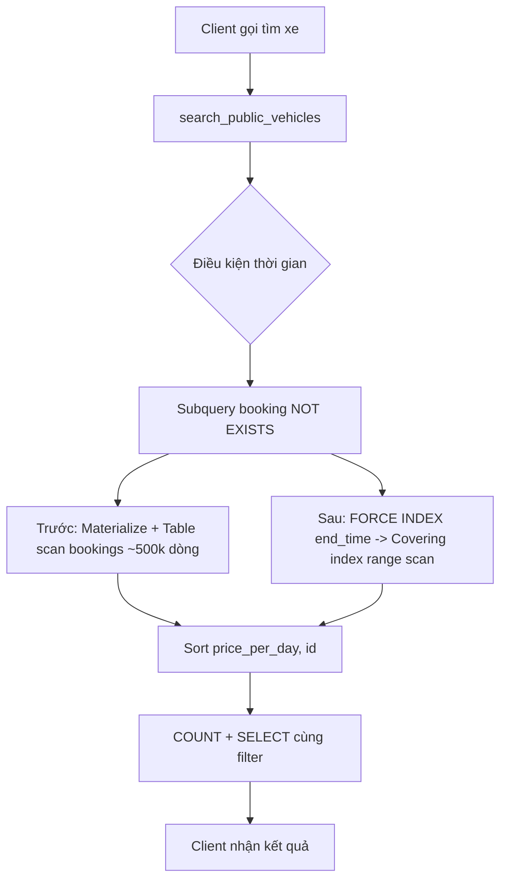
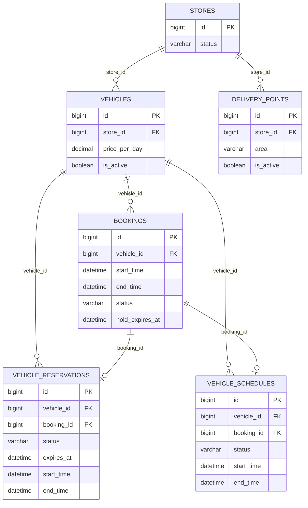
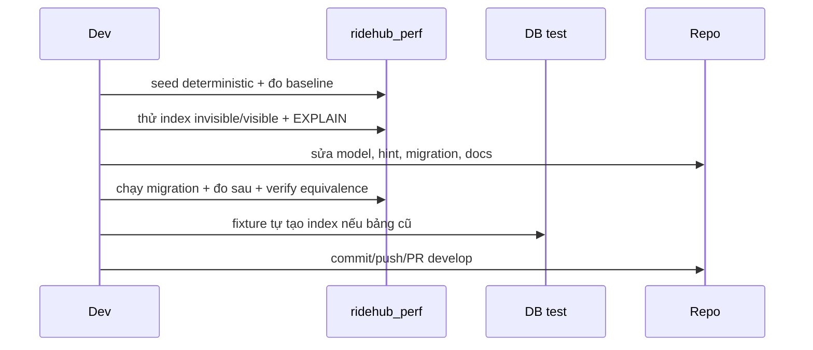

# TF199BD — Sơ đồ minh họa

## Luồng truy vấn trước và sau

## Vị trí index trên các bảng liên quan

Index mới:

- `BOOKINGS`: `(end_time, start_time, status, vehicle_id, hold_expires_at)` — dùng cho subquery xung đột trực tiếp.
- `DELIVERY_POINTS`: `(store_id, is_active, area)` — dùng cho filter khu vực ở S3.

## Trình tự triển khai an toàn

