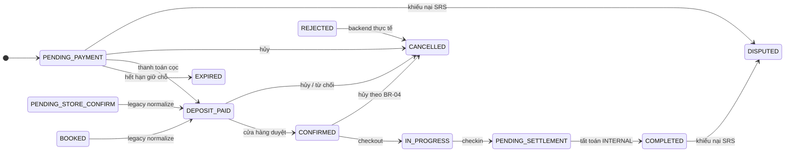
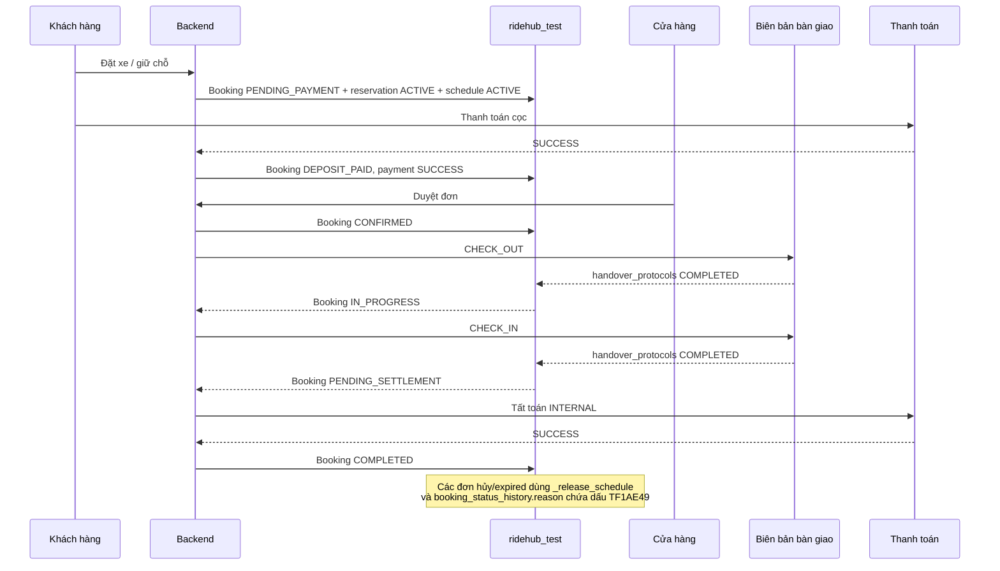
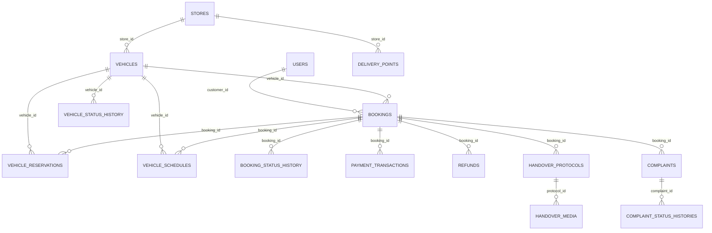

# TF1AE49 — Báo cáo dữ liệu mẫu đơn thuê nhiều trạng thái

## Tóm tắt

- DB: `ridehub_test`, MySQL `8.0.35`.
- Script: `backend/scripts/seed_demo_bookings.py`.
- Test: `backend/tests/test_seed_demo_bookings.py` — 4/4 passed.
- Dữ liệu tạo: 15 đơn, 124 dòng trên 10 bảng; chạy lại lần 2 không tăng số dòng.
- Trạng thái phủ: `PENDING_PAYMENT`, `DEPOSIT_PAID`, `CONFIRMED`, `IN_PROGRESS`, `PENDING_SETTLEMENT`, `COMPLETED`, `CANCELLED`, `EXPIRED`, cộng các nhãn legacy/SRS `PENDING_STORE_CONFIRM`, `BOOKED`, `DISPUTED`, `REJECTED`.
- Workbook: `docs/seed/TF1AE49-bang-don-mau.xlsx`.

## Giả định và giới hạn

1. `SRS_MotoGo.docx` không có trong repo; nguồn tham chiếu là workbook `TestCaseTimKiemDatXeGiuChoHuyDon-1794876312912.xlsx` và code/config hiện có.
2. DB test không có `booking_code`, `customer_note`, `store_confirmed_at`, `store_rejected_at`, `store_reject_reason`; script dùng dấu `[DEMO] TF1AE49:` trên các cột có sẵn.
3. `PENDING_STORE_CONFIRM`, `BOOKED`, `DISPUTED`, `REJECTED` không phải status canonical trong `app/core/booking_status.py`; dữ liệu mẫu được ghi nhãn rõ là legacy/SRS để demo giao diện và đối chiếu yêu cầu.
4. DB/code dùng `booking_status_history` và `handover_protocols`; SQL migrations dùng `booking_status_histories` và `handover_records`. Script bám schema DB/code thực tế và chỉ báo cáo lệch, không sửa migration.
5. Không có bảng `settlements`/`notifications`; tất toán được mô phỏng bằng `payment_transactions` với `provider='INTERNAL'`, `status='SUCCESS'`.

## Sơ đồ trạng thái

## Sơ đồ luồng dữ liệu

## Sơ đồ quan hệ dữ liệu

## Danh sách ảnh minh chứng cần chụp

| File dự kiến | Màn hình | Dữ liệu mẫu | Trạng thái |
|---|---|---|---|
| `docs/seed/evidence/TF1AE49-01-payment-qr.png` | `payment-qr` / `payment-result` | `DEMO-TF1AE49-01-PP-FRESH`, `02-PP-SOON` | Chưa chụp |
| `docs/seed/evidence/TF1AE49-02-store-orders.png` | `store-orders` | `DEMO-TF1AE49-03-DEPOSIT-PAID`, `04-PENDING-STORE`, `15-BOOKED-LEGACY` | Chưa chụp |
| `docs/seed/evidence/TF1AE49-03-handover.png` | `handover` | `DEMO-TF1AE49-06-IN-PROGRESS`, `09-COMPLETED` | Chưa chụp |
| `docs/seed/evidence/TF1AE49-04-trips.png` | Trips / lịch sử chuyến đi | `DEMO-TF1AE49-06-IN-PROGRESS`, `09-COMPLETED` | Chưa chụp |
| `docs/seed/evidence/TF1AE49-05-vehicle-search.png` | Tìm xe / lịch xe | `DEMO-TF1AE49-05-CONFIRMED` bị ẩn; `11-CANCEL-FULL` hiện lại | Chưa chụp |
| `docs/seed/evidence/TF1AE49-06-ops-anomalies.png` | Admin / Ops anomalies | `DEMO-TF1AE49-12-CANCEL-PARTIAL`, `13-CANCEL-LATE` | Chưa chụp |
| `docs/seed/evidence/TF1AE49-07-cancel-refund.png` | Hủy đơn / hoàn tiền | `DEMO-TF1AE49-11`, `12`, `13`, `14` | Chưa chụp |

Các ảnh trên chưa được chụp trong môi trường CLI; API tìm xe đã được kiểm chứng tự động bằng `TestClient` trong `test_TF1AE49_C4_api_tim_xe_phu_anhr`.

## Kết quả kiểm chứng

- 4 test tự động passed.
- 15 đơn, 12 nhãn trạng thái sau khi normalize legacy.
- Không có `schedule ACTIVE` chồng nhau sau buffer 60 phút.
- Đơn kết thúc không còn giữ chỗ/schedule ACTIVE.
- Hoàn tiền đúng BR-04: 100%, 50%, 0%; từ chối cửa hàng hoàn 100%.
- `--reset` chỉ xóa dữ liệu mang dấu TF1AE49; dữ liệu nền giữ nguyên.
