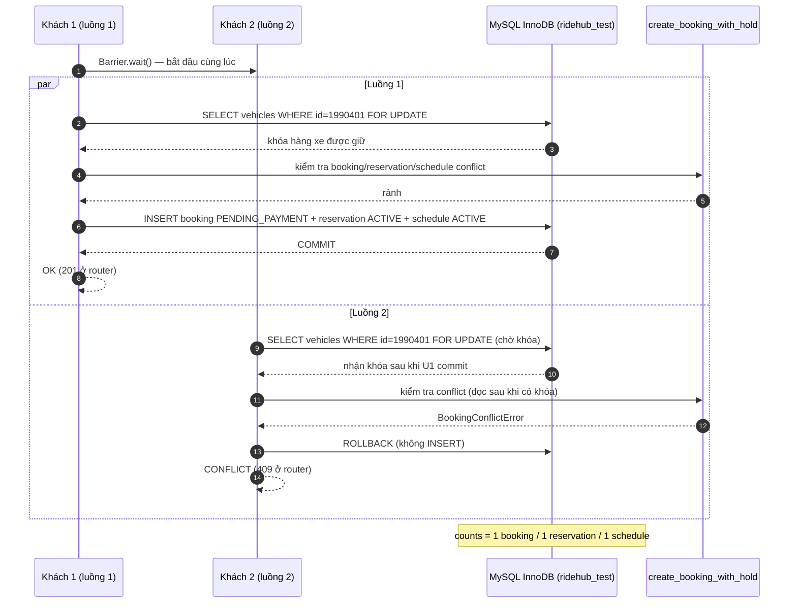

# TF19904 — Sơ đồ trình tự minh chứng

## A1 — 2 khách đặt cùng xe cùng lúc (1 thắng, 1 thua)



## B3 — Hết hạn giữ chỗ nhưng xe vẫn bị chặn (lỗi phát hiện)

```mermaid
sequenceDiagram
    autonumber
    participant T as Test (now = t0)
    participant CRUD as create_booking_with_hold
    participant DB as ridehub_test
    participant K as Khách khác (now = t0+30p)

    T->>CRUD: tạo đơn với now=t0
    CRUD->>DB: booking PENDING_PAYMENT, hold_expires_at=t0+30p
    CRUD->>DB: reservation ACTIVE, expires_at=t0+30p
    CRUD->>DB: schedule ACTIVE
    CRUD-->>T: OK
    Note over DB: Không có job chuyển sang EXPIRED

    T->>DB: đẩy mốc thời sang t0+30p+1s
    K->>DB: create_booking_with_hold(now=t0+30p+1s)
    DB->>DB: vehicle_has_conflict()
    Note right of DB: booking PENDING_PAYMENT vẫn nằm trong BLOCKING_BOOKING_STATUSES;<br/>schedule ACTIVE vẫn khớp khung giờ
    DB-->>K: BookingConflictError
    K-->>T: FAIL: xe bị chặn oan dù reservation đã hết hạn
```

## C1 — Hủy đơn chưa thanh toán, nhả lịch cho khách khác

```mermaid
sequenceDiagram
    autonumber
    participant K1 as Khách 1
    participant EP as POST /api/payments/booking/{id}/cancel
    participant DB as ridehub_test
    participant K2 as Khách 2

    K1->>EP: hủy đơn PENDING_PAYMENT
    EP->>DB: SELECT booking ... FOR UPDATE; kiểm tra owner
    EP->>DB: booking.status = CANCELLED
    EP->>DB: reservation.status = CANCELLED WHERE booking_id=...
    EP->>DB: schedule.status = CANCELLED WHERE booking_id=...
    EP->>DB: COMMIT
    EP-->>K1: {status: CANCELLED}

    K2->>DB: create_booking_with_hold(cùng xe/cùng khung)
    DB->>DB: conflict query bỏ qua CANCELLED
    DB-->>K2: OK — đặt lại thành công
```
