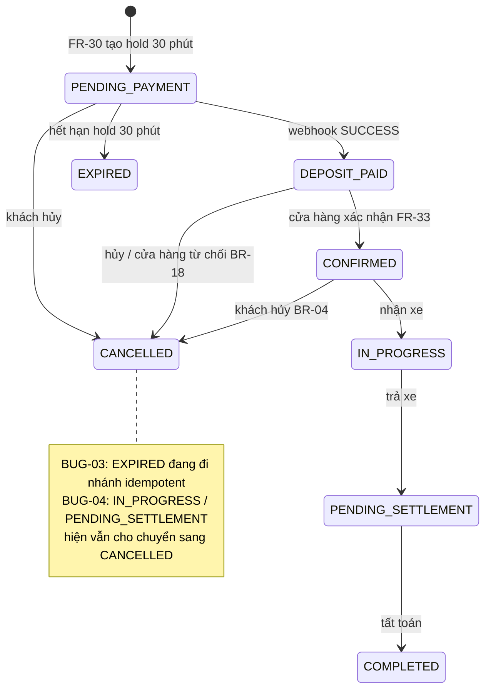
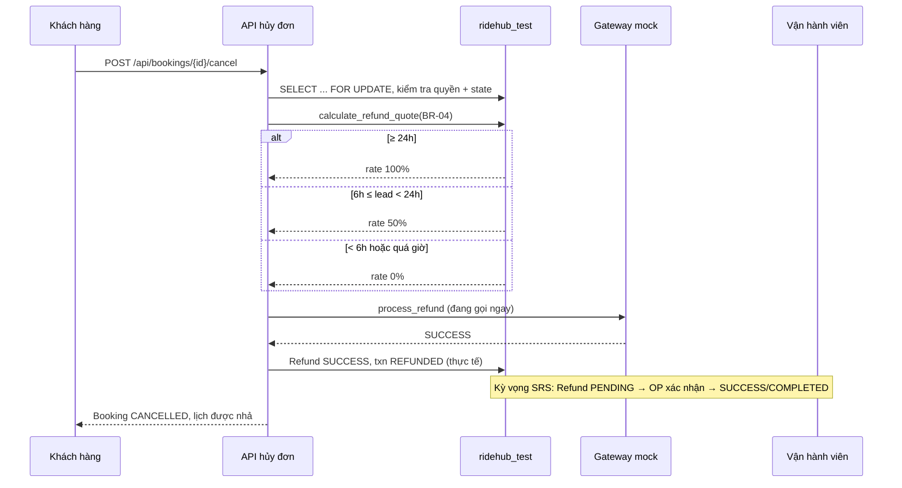

# TF19B54 — Báo cáo kiểm thử vòng đời đơn thuê, hủy đơn và hoàn tiền

## 1. Kết luận ngắn

- Chạy thật trên MySQL `ridehub_test`: **99 test case**, **92 PASS**, **7 FAIL**, **0 SKIP**.
- Không sửa code sản phẩm (`app/`, `sql/`, model/router/crud/service). Chỉ thêm test và tài liệu.
- Có **5 nhóm vấn đề** cần xử lý/xác nhận; chi tiết ở mục 6 và file `docs/test-results/TF19B54-ket-qua-kiem-thu.xlsx`.

## 2. Nguồn kỳ vọng và Step 0

### 2.1. Nguồn

- `SRS_MotoGo.docx` **không tìm thấy** trong repo, `/Users/ridole/Desktop` hoặc `/Users/ridole/Downloads` (đã thử `glob`, `mdfind`). Đây là câu hỏi mở số 1.
- Kỳ vọng dùng trong file test được trích từ workbook SRS có sẵn trên máy:
  `/Users/ridole/Downloads/TestCaseTimKiemDatXeGiuChoHuyDon-1794876312912.xlsx`
  (sheet `Test case`, `Dữ liệu mẫu`, `Ma trận truy vết`, `Giả định & câu hỏi`) và đối chiếu với `docs/test-results/TF19904-bao-cao.md`.
- Các nội dung không có trong workbook được ghi rõ là **giả định**: ma trận chuyển trạng thái đầy đủ, cách làm tròn `ROUND_HALF_UP`.

### 2.2. Quy tắc đã trích

| Mã | Quy tắc | Nguồn |
|---|---|---|
| BR-04 | Hoàn 100% nếu hủy từ 24h trở lên; 50% nếu từ 6h đến dưới 24h; 0% nếu dưới 6h hoặc sau giờ nhận. | Workbook `TC-HUY-01..06`, sheet `Điều kiện` |
| BR-04 boundary | Đúng 24h → 100%; đúng 6h → 50%; 23h59 → 50%; 5h59 → 0%. | Workbook sheet `Dữ liệu mẫu`, mục A |
| FR-35/FR-76 | Hủy theo chính sách, ghi refund và lịch sử; refund ban đầu ở `PENDING`, vận hành viên xác nhận mới `SUCCESS/COMPLETED`. | Workbook `TC-HUY-01`, `TC-HUY-13` |
| BR-18 | Cửa hàng/admin hủy do lỗi cửa hàng/sự cố xe → hoàn 100%, không trừ phí. | Workbook `TC-HUY-07..09` |
| FR-35 | Không cho hủy khi xe đang thuê; khách không được hủy đơn của người khác. | Workbook `TC-HUY-12`, `TC-HUY-15` |
| FR-30 | Hold 30 phút; tại 29:59 còn hiệu lực, tại 30:00 hết hạn. | Workbook `TC-GIU-05` |

### 2.3. Khảo sát code

| Thành phần | Phát hiện | File |
|---|---|---|
| Trạng thái tập trung | `PENDING_PAYMENT`, `DEPOSIT_PAID`, `CONFIRMED`, `IN_PROGRESS`, `PENDING_SETTLEMENT`, `COMPLETED`, `CANCELLED`, `EXPIRED`; alias `PENDING→PENDING_PAYMENT`, `BOOKED/ PENDING_STORE_CONFIRM → DEPOSIT_PAID`. | `backend/app/core/booking_status.py:8-63` |
| Enforce chuyển trạng thái | `can_transition()` chỉ được gọi trong luồng hủy; luồng khác tự kiểm tra. | `backend/app/core/booking_status.py:88-93`, `backend/app/crud/booking_cancellation.py:269-272` |
| Hủy đơn | Khóa dòng booking, kiểm tra quyền/state, tính quote, nhả reservation/schedule, ghi `Refund`, ghi history, commit. | `backend/app/crud/booking_cancellation.py:236-357` |
| Chính sách hoàn | `BOOKING_CANCEL_FREE_HOURS=24`, `PARTIAL_HOURS=6`, `PARTIAL_RATE=0.5`, `ROUND_HALF_UP`. | `backend/app/core/config.py:88-92`, `backend/app/services/cancellation_policy.py:34-143` |
| API hủy khách | `POST /api/bookings/{booking_id}/cancel`, actor lấy từ `current_user.id/role`. | `backend/app/routers/bookings.py:135-174` |
| API hoàn khác | `POST /api/payments/refund` ghi `Refund SUCCESS` ngay; `POST /api/operations/refunds/{id}/confirm` xác nhận refund `PENDING`. | `backend/app/routers/payment.py:1330-1436`, `1440-1569` |
| Job hết hạn hold | `expire_hold_bookings()`, biên dùng `hold_expires_at <= now`. | `backend/app/jobs/booking_expiry_job.py`, `backend/app/crud/booking_cancellation.py:360-453` |
| DB/model | `bookings.status` là `VARCHAR(40)` không có CHECK; model đã có `cancelled_at`, `cancelled_by`, `cancel_reason` và bảng history. | `backend/app/models/booking.py:45-96` |

## 3. Phạm vi đã chạy

| Nhóm | Số case | PASS | FAIL | Nội dung |
|---|---:|---:|---:|---|
| B — Hủy/hoàn tiền | 17 | 15 | 2 | BR-04, biên 24h/6h, muộn/sau giờ, unpaid, làm tròn, paid-only, idempotent, preview, actor-dependent |
| A — Vòng đời/trạng thái | 73 | 69 | 4 | Ma trận 8×8, happy path, invalid/terminal, history, alias legacy, hold expiry |
| C — Nhất quán dữ liệu | 9 | 8 | 1 | Giải phóng lịch, `current_status`, cột refund, rollback, phân quyền, đồng thời |
| **Tổng** | **99** | **92** | **7** | Không có test bị skip |

## 4. Môi trường và lệnh chạy

- Ngày chạy: `2026-11-25T17:29:22+07:00` (theo JUnit XML).
- Python `3.14.5`, pytest `9.2.0`, MySQL `8.0.35`.
- Database: `ridehub_test`. Test file có guard: nếu thiếu `TEST_DATABASE_URL`, không phải MySQL, hoặc tên DB không chứa `"test"` thì skip; không đụng `app_db`.
- Branch: `feature/tf19b54-kiem-thu-vong-doi-huy-don`, base `origin/develop @ b6113af`.
- Lệnh:

```bash
cd backend
TEST_DATABASE_URL='<mysql-test-url>' \
  ../.venv/bin/python -m pytest tests/test_booking_lifecycle_cancel_refund.py \
  -q --disable-warnings --tb=no \
  --junitxml=/var/folders/29/8lpg5hyj24g11yqnhrd4nfs40000gn/T/opencode/tf19b54-junit.xml
```

## 5. Kết quả chi tiết

File `docs/test-results/TF19B54-ket-qua-kiem-thu.xlsx` có các sheet:

1. `Test case` — 99 dòng, trạng thái PASS/FAIL lấy trực tiếp từ JUnit XML.
2. `Bảng hoàn tiền theo mốc` — số tiền kỳ vọng/thực tế cho 25h, 24h01, 24h00, 23h59, 6h01, 6h00, 5h59, 0h30, sau giờ nhận.
3. `Ma trận trạng thái` — 64 ô 8×8, kỳ vọng/thực tế.
4. `Lỗi phát hiện` — 5 bản ghi BUG.
5. `Môi trường` — cấu hình chạy và nguồn kỳ vọng.
6. `Tổng hợp` — 92/99 PASS, 7/99 FAIL.

### 5.1. Bảng hoàn tiền theo mốc (deposit mẫu 540.000đ)

| Mốc | Kỳ vọng | Thực tế tiền | Kết quả |
|---|---:|---:|---|
| 25h | 540.000đ (100%) | 540.000đ | Tiền đúng; trạng thái refund SAI (BUG-01) |
| 24h01 | 540.000đ (100%) | 540.000đ | PASS |
| 24h00 | 540.000đ (100%) | 540.000đ | PASS |
| 23h59 | 270.000đ (50%) | 270.000đ | PASS |
| 6h01 | 270.000đ (50%) | 270.000đ | PASS |
| 6h00 | 270.000đ (50%) | 270.000đ | PASS |
| 5h59 | 0đ | 0đ | PASS |
| 0h30 / sau giờ nhận | 0đ | 0đ | PASS |

## 6. Lỗi phát hiện

| Mã | Mức | Test | Kỳ vọng | Thực tế | Vị trí |
|---|---|---|---|---|---|
| TF19B54-BUG-01 | Cao | `TC-B1` | Refund `PENDING` để operator xác nhận (`TC-HUY-13`). | `cancel_booking()` gọi gateway sandbox và ghi `Refund.status = SUCCESS`, transaction chuyển `REFUNDED` ngay. | `backend/app/crud/booking_cancellation.py:295-326` |
| TF19B54-BUG-02 | Trung bình | `TC-B9` | Có khả năng xem trước số tiền hoàn trước khi hủy. | Không có route nào chứa `refund-preview` trong `app.routes`. | `backend/app/routers/bookings.py`, `backend/app/routers/payment.py` |
| TF19B54-BUG-03 | Cao | `TC-A3[EXPIRED]`, `TC-A4[EXPIRED]` | `EXPIRED` là terminal: từ chối 409, không ghi thêm. | `cancel_booking()` trả kết quả idempotent, không raise HTTP 409. | `backend/app/crud/booking_cancellation.py:256-258` |
| TF19B54-BUG-04 | Trung bình | `TC-A1` 2 ô | `IN_PROGRESS → CANCELLED` và `PENDING_SETTLEMENT → CANCELLED` bị từ chối theo ma trận giả định. | `ALLOWED_TRANSITIONS` cho phép cả hai cạnh. | `backend/app/core/booking_status.py:54-63` — **chờ xác nhận SRS gốc** |
| TF19B54-BUG-05 | Cao | `TC-C6` | Hủy khi dòng booking đang bị khóa phải chờ hoặc trả idempotent. | `FOR UPDATE SKIP LOCKED` làm request thứ hai trả `404 Không tìm thấy đơn đặt xe`. | `backend/app/crud/booking_cancellation.py:107-110,250-255` |

Các case FAIL trùng nhóm lỗi: BUG-03 xuất hiện ở 2 case, BUG-04 ở 2 ô ma trận; vì vậy 5 BUG nhưng 7 case FAIL.

## 7. Sơ đồ trạng thái



## 8. Timeline hoàn tiền theo BR-04



## 9. Danh sách minh chứng/chụp màn hình

- Không có UI thao tác trong task này; không tạo ảnh màn hình giả. Minh chứng là log pytest + JUnit XML + workbook Excel.
- Có thể chụp terminal khi cần với các lệnh:

| Ảnh đề xuất | Lệnh |
|---|---|
| `TF19B54-full-run.png` | Lệnh chạy toàn bộ file ở mục 4 |
| `TF19B54-bug-01.png` | `pytest tests/test_booking_lifecycle_cancel_refund.py::test_B1_cancel_25h_before_creates_full_refund_with_pending_status -v` |
| `TF19B54-bug-05.png` | `pytest tests/test_booking_lifecycle_cancel_refund.py::test_C6_concurrent_cancel_under_lock_has_no_error -v` |

## 10. Giả định và câu hỏi mở

1. Cần cung cấp `SRS_MotoGo.docx` gốc để trích nguyên văn BR/FR và chốt ma trận trạng thái. Hiện dùng workbook SRS trên máy.
2. BUG-04 chỉ kết luận là lỗi nếu SRS xác nhận `IN_PROGRESS/PENDING_SETTLEMENT → CANCELLED` là không hợp lệ.
3. Cách làm tròn tiền hoàn: test dùng `ROUND_HALF_UP` theo code `cancellation_policy.py`; cần xác nhận SRS có quy định khác không.
4. `refund-preview` có phải endpoint riêng hay chỉ là bước tính trong UI? Hiện test kỳ vọng có endpoint theo tên yêu cầu của task.
5. Refund `PENDING` hay `SUCCESS` ngay sau hủy: workbook SRS nói `PENDING`, code đang `SUCCESS`; cần sản phẩm chốt trước khi sửa.

## 11. Phạm vi không làm

- Không sửa `app/`, `sql/`, schema DB production/dev.
- Không commit `TEST_DATABASE_URL`, mật khẩu DB, `.env`, `serviceAccountKey.json`.
- Không ghi Pass cho test chưa chạy; mọi số liệu trong báo cáo lấy từ JUnit XML chạy ngày 25/11/2026.

## 12. Kiểm tra hồi quy full suite

- Lệnh: `TEST_DATABASE_URL=<mysql-test-url> ../.venv/bin/python -m pytest -q --disable-warnings --tb=no` tại `backend/`.
- Kết quả: **306 PASS, 11 FAIL, 2 SKIP** (319 test).
- Trong 11 FAIL: 7 case thuộc TF19B54 như bảng trên; 4 case là lỗi có sẵn ngoài phạm vi task:
  - `tests/test_booking_concurrency_hold_cancel.py::test_TC_A7_no_orphan_rows_after_conflict`
  - `tests/test_booking_concurrency_hold_cancel.py::test_TC_C5_terminal_status_and_repeated_cancel`
  - `tests/test_booking_concurrency_hold_cancel.py::test_TC_C6_concurrent_cancel_and_cancel_vs_rebook`
  - `tests/test_chatbot_ai.py::test_02_knowledge_base_rag_context_building`
- Đã chạy riêng 4 case trên với cùng `TEST_DATABASE_URL`; chúng vẫn FAIL khi không có file test TF19B54, nên không phải lỗi do test mới gây ra. Không sửa các test/code này trong task TF19B54.
